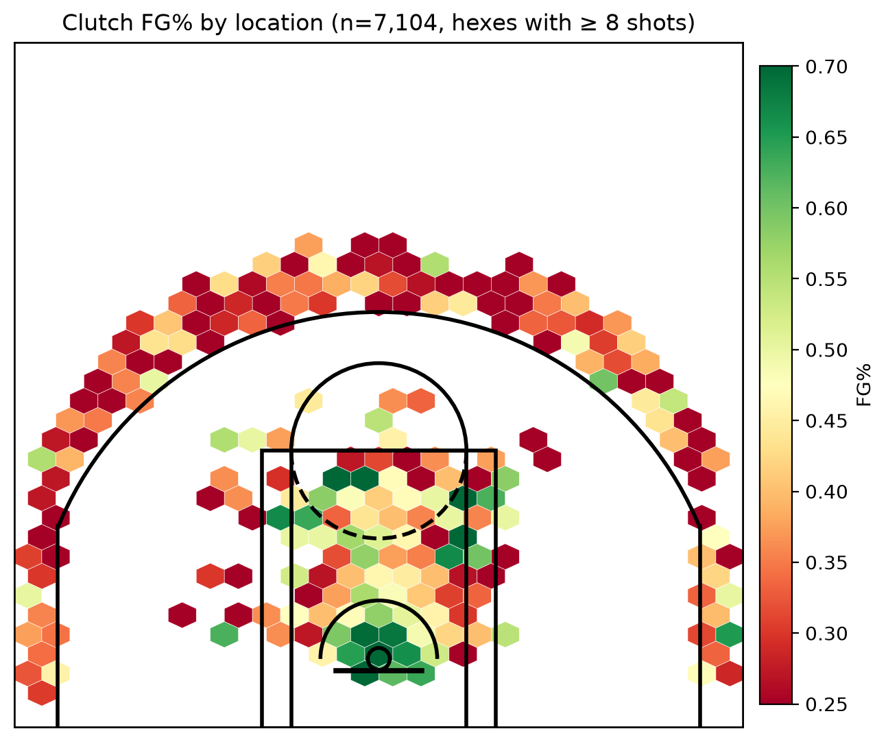

# NBA Clutch Decision Engine

A sports analytics and machine learning project that models **shot quality in NBA clutch time** and turns it into **Expected Points (xP)** to compare late-game offensive options.

> **Status:** 🚧 Work in progress. The data pipeline (Phases 1 and 2) is complete for the 2025-26 regular season; modelling and the simulator are planned. See the [Roadmap](#roadmap).



*Field-goal percentage by court location for clutch shots (last 5 minutes, score margin ≤ 5). Only locations with enough attempts are shown.*

---

## Motivation

Modern analytics tends to penalize mid-range jumpers in favor of layups and threes. But in the last five minutes of a close game, the context changes:

- Pace slows down and transition opportunities disappear.
- Defenses tighten, switch, and pack the paint.
- Stars (Brunson, Shai Gilgeous-Alexander, Jokić) take a disproportionate share of self-created shots.

Season-long averages and box scores don't capture that context: score margin, time left, court location, shot type. This project asks:

> Given the game state, how does shot efficiency shift under pressure, and which shot type and location carry the highest expected value?

## Approach

1. **Ingest** shot-level data from the NBA stats API (`nba_api`) and cache it locally as Parquet.
2. **Enrich** shots with play-by-play data to attach the exact score margin *before* each attempt (using the score after the shot would leak the outcome into the features).
3. **Model** `P(make | shot context)` with gradient-boosted trees (XGBoost), with an emphasis on **probability calibration**, not just accuracy.
4. **Convert** probabilities to expected points:

   ```
   xP = P(make | X) × shot value (2 or 3)
   ```

5. **Decide**: in an interactive Streamlit app, compare options for a given game state. In tight situations (e.g. down 3 late), raw xP isn't the right objective, so the simulator will also report the probability of tying or taking the lead.

Everything runs locally on a laptop CPU. No GPU and no cloud services.

### Clutch definition

A shot counts as clutch if it is taken in the **last 5 minutes of the 4th quarter or overtime**, with the **score margin within 5 points** (measured before the shot, from the shooting team's perspective).

## Roadmap

| Phase | Deliverable | Status |
| :--- | :--- | :--- |
| 1. Foundation | Fetch league-wide shot data, cache to Parquet, half-court plotting | ✅ Done |
| 2. Context enrichment | Merge play-by-play to add pre-shot score margin; filter to clutch shots; validate | ✅ Done (2025-26 regular season) |
| 3. ML engine | Feature engineering, XGBoost classifier, calibration (Brier score, reliability curves), player residuals | ⬜ Planned |
| 4. Simulator | Streamlit app with game-state inputs and an xP heatmap on the court | ⬜ Planned |

## Setup

Requires Python 3.10+.

```bash
git clone <your-repo-url>
cd <repo-folder>

python -m venv venv
source venv/bin/activate          # Windows: venv\Scripts\activate
pip install -r requirements.txt
```

## Usage

Run the pipeline in order. Every download step is cached, so reruns skip anything already fetched.

```bash
python src/fetch_clutch_shots.py     # 1. shots for every team -> data/
python src/fetch_pbp.py              # 2. play-by-play for each game with late-game shots
python src/build_clutch_dataset.py   # 3. join shots + play-by-play -> data/processed/clutch_shots.parquet
python src/check_leakage.py          # 4. sanity check on the pre-shot score logic
python src/diagnostics.py            # 5. coverage, FG% by zone, shots per player
python src/plot_shots.py             # 6. shot map -> docs/clutch_shot_map.png
```

Notes:

- Step 1 takes a few minutes and step 2 takes roughly 30 to 40 minutes per season, because requests are spaced out to avoid rate limiting. Both are resumable.
- `fetch_pbp.py --limit 20` downloads only the first 20 games, which is handy for testing the rest of the pipeline quickly.

## Data

| Source | Used for |
| :--- | :--- |
| `ShotChartDetail` (`nba_api`) | Shot location (`LOC_X`, `LOC_Y`), distance, zone, action type, clock, result |
| `PlayByPlayV3` (`nba_api`) | Score before each event, shooter's side (home/away) |

`PlayByPlayV2` no longer returns data from the NBA API, so the pipeline uses V3.

Data is **not** committed to the repo. It is reproducible by running the pipeline above.

### Current dataset

Only the 2025-26 regular season is loaded so far.

| | |
| :--- | :--- |
| Games with play-by-play | 1,230 of 1,230 |
| Late-game shots (last 5 min, 4th quarter or OT) | 22,962 |
| Clutch shots (also within 5 points) | 7,104 across 543 games |
| Players with at least one clutch shot | 413 |
| Clutch shots per player | median 11, max 101; 76 players have 30 or more |

Field-goal percentage on clutch shots passes a basic sanity check against known league patterns: restricted area 65%, non-restricted paint 42%, mid-range 38%, above-the-break threes 30%.

## Data validation

A model is only as good as its inputs, so the pipeline includes explicit checks:

- **Join integrity.** Shots are joined to play-by-play on `GAME_ID` and `GAME_EVENT_ID`. 100% of shots matched, and 100% of matched shots had identical court coordinates in both sources, which confirms the join pairs the right events and not just plausible ones.
- **No outcome leakage.** The margin is computed from the score *before* each shot. `check_leakage.py` verifies this: for every made field goal, the score change on that row must equal the shot value. Across the full season, 12 of 103,227 made field goals (0.01%) do not match. Made and missed shots also have the same average pre-shot margin (difference 0.02 points, z = 0.3), as they should if the margin carries no information about the outcome.
- **Event ordering.** The check caught a real bug in an earlier version: play-by-play events are not always in chronological order by `actionNumber`, because some corrected events receive a later number. Ordering by `actionId` instead fixed it, cutting mismatches from 368 (0.36%) to 12 (0.01%).
- **Plausibility checks.** Margins stay within ±5 and are centered on a tied game, and field-goal percentages by shot type and zone land in realistic ranges.

## Planned features

- `SCORE_MARGIN`: lead or deficit from the shooting team's perspective, before the shot *(built)*
- `TIME_REMAINING_SEC`: seconds left in the period
- `SHOT_DISTANCE`, `SHOT_ANGLE`: polar coordinates derived from `LOC_X`, `LOC_Y`
- `SHOT_VALUE`: 2PT or 3PT attempt
- Shot type / action type, season, regular season vs. playoffs

Model evaluation will split by **season** (train on earlier seasons, test on the latest), not randomly, to avoid shots from the same game appearing on both sides of the split.

## Known limitations

Being upfront about what this model can and can't claim:

- **Selection bias.** The model learns from shots that were *taken*, not from alternatives that weren't. It estimates shot quality, not the causal effect of choosing a different shot.
- **No defender information.** The shot chart data has no contest distance or defender context, which is a major driver of shot quality.
- **Small samples.** A single season gives about 7,100 clutch shots, and the median player has only 11 of them. Player-level effects will be shrunk toward the league average rather than reported raw.
- **Assisted vs. unassisted shots** aren't equivalent options. A kick-out three requires a pass first, and the assist information in play-by-play only exists for made shots, so it can't be used as a feature without leaking the outcome.
- **No free throws or turnovers** in the shot chart, so drawing fouls isn't captured in xP.

## Project structure

```text
.
├── src/
│   ├── fetch_clutch_shots.py     # download shots per team (cached)
│   ├── fetch_pbp.py              # download play-by-play per game (cached)
│   ├── build_clutch_dataset.py   # join + pre-shot margin + clutch filter
│   ├── check_leakage.py          # sanity check on the score logic
│   ├── diagnostics.py            # coverage, FG% by zone, shots per player
│   ├── court.py                  # half-court drawing
│   └── plot_shots.py             # shot map
├── docs/                         # figures used in this README
├── data/                         # gitignored: raw and processed Parquet files
└── requirements.txt
```

## Tech stack

Python · pandas · PyArrow/Parquet · nba_api · XGBoost · scikit-learn · Matplotlib · Streamlit

## Acknowledgments

Data from [`nba_api`](https://github.com/swar/nba_api), a client for the public NBA stats endpoints. This project is not affiliated with or endorsed by the NBA.