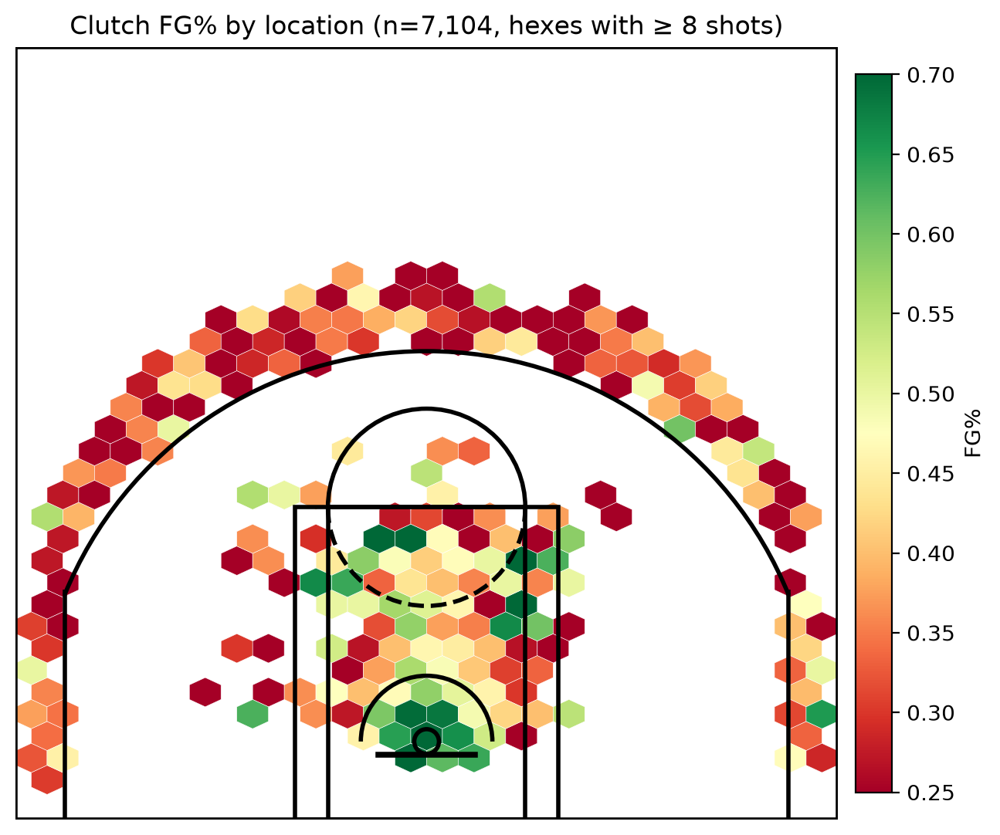
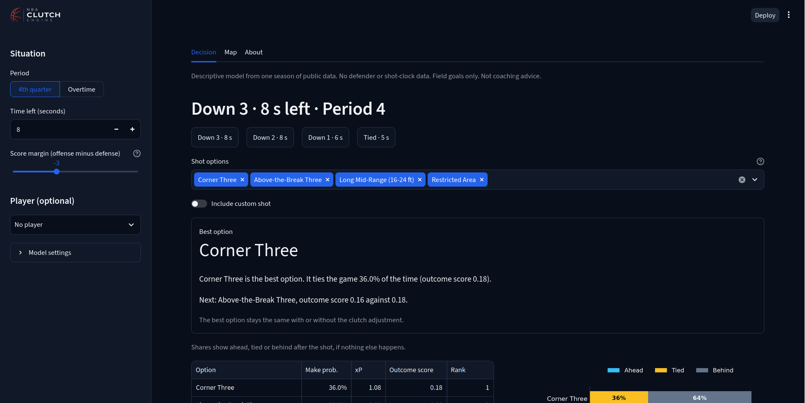
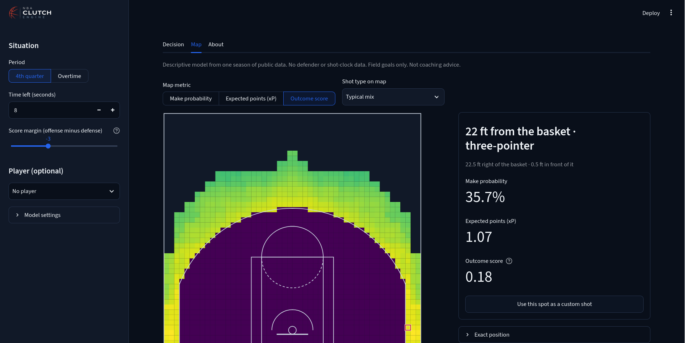
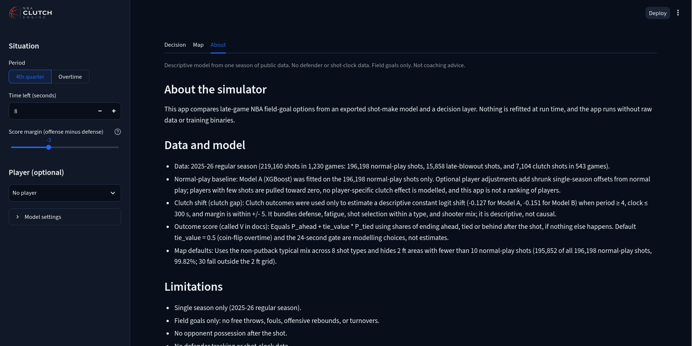
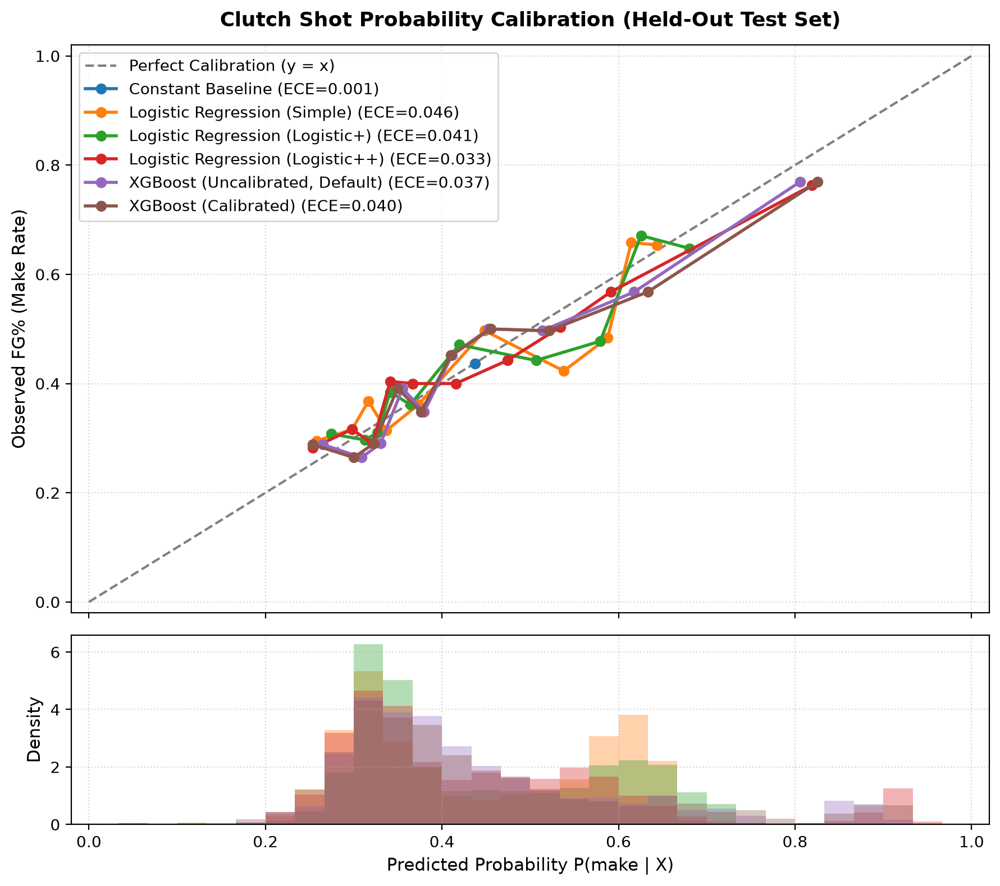
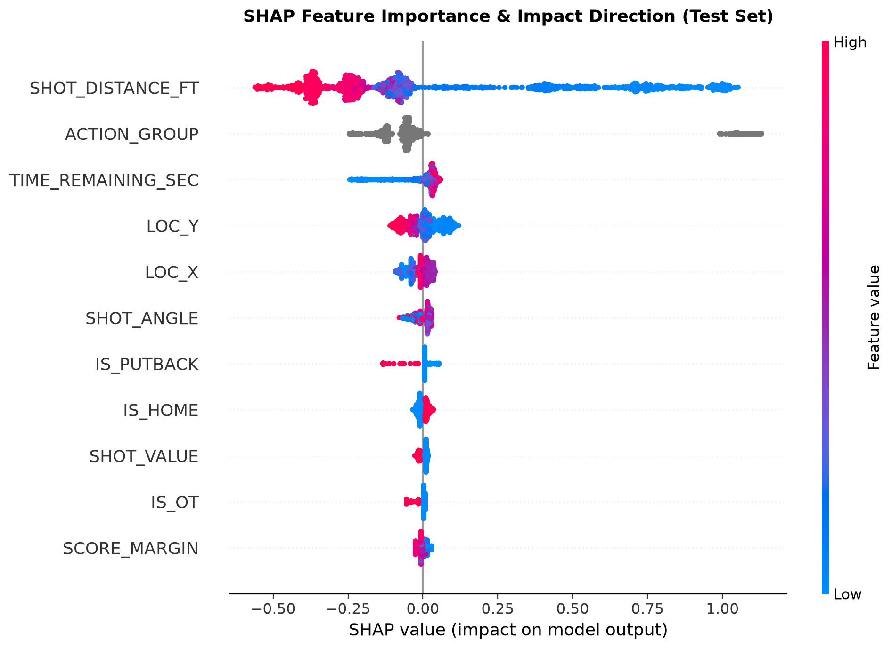
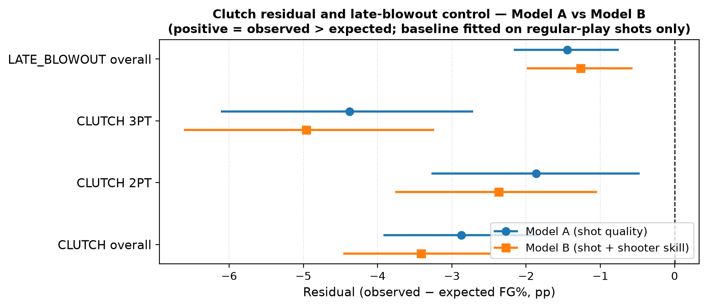
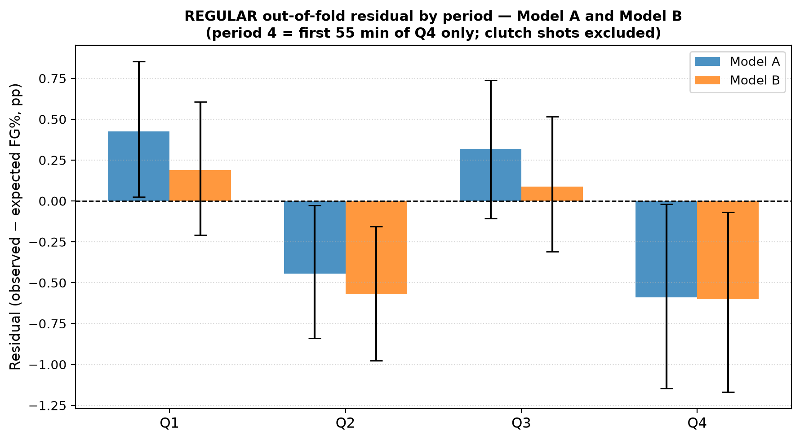

<p>
  <picture>
    <source media="(prefers-color-scheme: dark)" srcset="app/assets/nba-clutch.png">
    
  </picture>
</p>

# NBA Clutch Decision Engine

A sports analytics and machine learning project that models **shot quality in NBA clutch time** and turns it into **Expected Points (xP)** to compare late-game offensive options. It also measures how clutch shooting differs from normal play.

> **Status:** Phases 1 to 4 are complete for the 2025-26 regular season: the data pipeline, the shot-quality model, the clutch-versus-normal-play analysis and an interactive simulator. More seasons and a replay mode are under consideration. See the [Roadmap](#roadmap).



*Field-goal percentage by court location for clutch shots (last 5 minutes, score margin ≤ 5). Only locations with enough attempts are shown.*

## The simulator

An interactive app compares shot options in a late-game situation. You set the score margin, the time left and, if you want, the player taking the shot. For each option the app shows the chance of making the shot, the expected points, and the chance of ending **ahead, tied or behind** after the shot, if nothing else happens. A half-court map shows the same numbers for every spot on the court, and you can click a spot to inspect it.



*Decision tab: the shot options ranked for the situation you set.*



*Map tab: the same numbers for every spot on the half court. Click a spot to inspect it.*



*About tab: the method, the data and the limitations.*

Run it locally. It needs only the small model files in `export/`, which are in the repo, not the downloaded data:

```bash
pip install -r app/requirements.txt
streamlit run app/streamlit_app.py
```

The app is descriptive. It has no defender or shot-clock data, it covers field goals only, and it is not coaching advice. [Part 3](#part-3-the-simulator) explains how it works.

---

## Key findings

- **Where the shot is taken and what type it is explain almost everything the model can predict.** Together they account for about 89% of the total SHAP attribution. Inside the clutch window, clock time, score margin, home court and overtime add no detectable predictive gain (with about 7,100 shots, small effects cannot be ruled out).
- **The shot-quality model is useful but modest.** On held-out games its Brier score is about 9% lower than a constant guess and its ROC AUC is 0.66. It is well calibrated without any correction, and it is not detectably better than a well-built logistic regression.
- **Clutch shots go in less often than comparable normal-play shots.** Observed FG% is 43.75% against 47.2% expected, a gap of **3.4 percentage points** (95% interval 2.5 to 4.5). Changing the baseline model moves this number by at most 0.14 points. It is a descriptive gap, not a measured "pressure effect".
- **The gap is not the same everywhere.** Two-point shots are clearly worse in close games than in late blowouts. Three-point shots are worse late in the game in both. The last minute is the worst part (exploratory).
- **No player-level differences are detectable.** The data cannot rule out real differences of up to about 5 percentage points, but it cannot show any either.
- **The simulator is built on that result.** A model trained on normal play plus one clutch correction predicts clutch shots at least as well as a model trained on clutch shots only.
- **Game state barely changes the make probability, but it changes which shot is best.** Down 3 with 8 seconds left, a restricted-area shot has the most expected points (1.28), but a 2-pointer cannot tie. A corner three ranks first instead, and in the model it ties the game about 36% of the time. This is a model output under stated assumptions, not coaching advice.

## Motivation

Modern analytics tends to penalize mid-range jumpers in favor of layups and threes. The last five minutes of a close game plausibly change the picture: pace slows down, defenses tighten, and stars take a large share of self-created shots. Season-long averages and box scores don't capture that context: score margin, time left, court location, shot type. This project asks:

> Given the game state, how does shot efficiency shift under pressure, and which shot type and location carry the highest expected value?

The results so far answer both halves. Location and shot type decide most of the value of a shot. And clutch shots do go in less often than comparable shots in normal play, although the data cannot say why. The simulator puts both answers into one tool.

## Approach

1. **Ingest** shot-level data from the NBA stats API (`nba_api`) and cache it locally as Parquet.
2. **Enrich** shots with play-by-play data to attach the exact score margin *before* each attempt (using the score after the shot would leak the outcome into the features).
3. **Model** `P(make | shot context)` on clutch shots with gradient-boosted trees (XGBoost), with an emphasis on **probability calibration**, and compare it against a fair logistic regression baseline.
4. **Compare clutch with normal play.** Fit a second shot-quality model on normal-play shots only, and measure how far clutch results fall from what it expects (the "clutch residual").
5. **Convert** probabilities to expected points:

   ```
   xP = P(make | X) × shot value (2 or 3)
   ```

6. **Decide.** In an interactive Streamlit app, compare shot options for a given game state. Near the end of a game, raw xP is not the right objective (down 3, a 2-pointer cannot tie), so the app also reports the chance of ending ahead, tied or behind after the shot.

Everything runs locally on a laptop CPU, with no GPU. The app needs only the small model files in `export/`, so it can also be hosted.

### Clutch definition

A shot counts as clutch if it is taken in the **last 5 minutes of the 4th quarter or overtime**, with the **score margin within 5 points** (measured before the shot, from the shooting team's perspective).

## Roadmap

| Phase | Deliverable | Status |
| :--- | :--- | :--- |
| 1. Foundation | Fetch league-wide shot data, cache to Parquet, half-court plotting | ✅ Done |
| 2. Context enrichment | Merge play-by-play to add pre-shot score margin; filter to clutch shots; validate | ✅ Done (2025-26 regular season) |
| 3. ML engine | Feature engineering, baselines, XGBoost, calibration, ablation, SHAP, prediction API | ✅ Done (v1) |
| 3b. Clutch versus normal play | All-shots baseline, clutch residual, late-game control, player-level check, predictive comparison | ✅ Done |
| 4a. Model export | Portable export of the normal-play model, shooter offsets and clutch shift (`export/`), with a loader that does not need the data | ✅ Done |
| 4b. Decision layer | Make probability, xP and chance of ending ahead, tied or behind for each shot option (field goals only), with zone presets | ✅ Done |
| 4c. Simulator app | Streamlit app with a decision tab and a clickable half-court map | ✅ Done |
| 4d. Replay mode | Play a recorded game event by event | ⬜ Under consideration |

## Setup

Requires Python 3.12 or newer (developed on 3.14).

```bash
git clone https://github.com/jlage24/nba-clutch-engine.git
cd nba-clutch-engine

python -m venv venv
source venv/bin/activate          # Windows: venv\Scripts\activate
pip install -r requirements.txt
pip install -r requirements-dev.txt   # only needed to run the tests
```

## Usage

Run the pipeline in order. Every download step is cached, so reruns skip anything already fetched.

```bash
python src/fetch_clutch_shots.py       # 1. shots for every team -> data/
python src/fetch_pbp.py                # 2. play-by-play for each game with late-game shots
python src/build_clutch_dataset.py     # 3. join shots + play-by-play -> data/processed/clutch_shots.parquet
python src/check_leakage.py            # 4. sanity check on the pre-shot score logic
python src/diagnostics.py              # 5. coverage, FG% by zone, shots per player
python src/plot_shots.py               # 6. shot map -> docs/clutch_shot_map.png
python src/features.py                 # 7. feature table and split summary
python src/train.py                    # 8. baselines, XGBoost, calibration, metrics, saved models
python src/explain.py                  # 9. SHAP plots and summaries -> docs/
python src/predict.py                  # 10. demo: P(make) and xP for a few hand-made shots, raw and Platt-calibrated side by side

# Phase 3b: clutch versus normal play
python src/build_all_shots_dataset.py  # 11. all 219,160 shots with pre-shot margin and set labels
python src/baseline_model.py           # 12. cross-fitted baseline on normal-play shots (Model A)
python src/shooter_offsets.py          # 13. shooter-skill offsets (Model B)
python src/clutch_effect.py            # 14. clutch residuals, controls, exploratory cuts, figures
python src/sensitivity.py              # 15. sensitivity checks
python src/player_clutch.py            # 16. player-level differential
python src/predictive_comparison.py    # 17. predictive comparison on clutch shots

# Phase 4: simulator
python src/export_model.py             # 18. portable model export -> export/
python src/export_zone_presets.py      # 19. zone presets -> export/zone_presets.json
python src/export_court_defaults.py    # 20. typical shot-type mix and map mask -> export/court_defaults.json
python src/generate_simulator_doc.py   # 21. docs/simulator_export.md, generated from export/ and docs/
python src/demo_decision.py            # 22. demo scenarios -> docs/decision_demo.json, docs/decision_layer.md
streamlit run app/streamlit_app.py     # run the app (needs only export/)

pytest                                 # run the unit tests
```

Notes:

- Step 1 takes a few minutes and step 2 takes roughly 30 to 40 minutes per season, because requests are spaced out to avoid rate limiting. Both are resumable.
- `fetch_pbp.py --limit 20` downloads only the first 20 games, which is handy for testing the rest of the pipeline quickly.
- Trained models are written to `models/` (gitignored), including the XGBoost model in portable JSON format.
- Tests that need generated data or trained models are skipped until the pipeline has run.
- The app and its tests need only the files in `export/`, which are committed to the repo. Steps 18 to 20 rebuild those files and need the data.

## Data

| Source | Used for |
| :--- | :--- |
| `ShotChartDetail` (`nba_api`) | Shot location (`LOC_X`, `LOC_Y`), distance, zone, action type, clock, result |
| `PlayByPlayV3` (`nba_api`) | Score before each event, shooter's side (home/away) |

`PlayByPlayV2` no longer returns data from the NBA API, so the pipeline uses V3.

Data is **not** committed to the repo. It is reproducible by running the pipeline above.

### Current dataset

Only the 2025-26 regular season is loaded so far.

| | |
| :--- | :--- |
| Games with play-by-play | 1,230 of 1,230 |
| All field-goal attempts | 219,160 |
| Normal play (outside the last 5 min of the 4th quarter and overtime) | 196,198 |
| Late game, margin above 5 ("late blowout", used as a control) | 15,858 |
| Late-game shots (last 5 min, 4th quarter or OT, any margin) | 22,962 |
| Clutch shots (late game and margin within 5) | 7,104 across 543 games |
| Players with at least one clutch shot | 413 |
| Clutch shots per player | median 11, max 101; 76 players have 30 or more |

## Data validation

A model is only as good as its inputs, so the pipeline includes explicit checks:

- **Join integrity.** Shots are joined to play-by-play on `GAME_ID` and `GAME_EVENT_ID`. 100% of the late-game shots matched, and 100% of matched shots had identical court coordinates in both sources, which confirms the join pairs the right events and not just plausible ones.
- **No outcome leakage.** The margin is computed from the score *before* each shot. `check_leakage.py` verifies this: for every made field goal, the score change on that row must equal the shot value. Across the full season, 12 of 103,227 made field goals (0.01%) do not match. Made and missed shots also have the same average pre-shot margin (difference 0.02 points, z = 0.3), as they should if the margin carries no information about the outcome.
- **Event ordering.** The check caught a real bug in an earlier version: play-by-play events are not always in chronological order by `actionNumber`, because some corrected events receive a later number. Ordering by `actionId` instead fixed it, cutting mismatches from 368 (0.36%) to 12 (0.01%).
- **All-shots table.** The table with all 219,160 shots has no duplicates, and 219,159 matched to play-by-play. The one unmatched shot is a third-quarter attempt; it is kept as normal play, and the build fails if an unmatched shot ever falls in the last 5 minutes. The clutch subset reproduces the earlier clutch table exactly (same shots, same margins). Eight shots have slightly different coordinates in the two sources; all are in normal play, and the models only use the shot-chart coordinates. A shooter-side version of the score check finds 11 mismatches among the 103,227 made field goals, 2 of them in clutch shots (margins of 1 and 2 points, so their classification is not affected).
- **Plausibility checks.** Margins stay within ±5 and are centered on a tied game, and field-goal percentages by shot type and zone land in realistic ranges (restricted area 65%, mid-range 38%, above-the-break threes 30%).
- **Placeholder coordinates.** Coordinates exactly at (0, 0) occur almost exclusively on tip and putback attempts (98.65% of such clutch shots; 98.11% across all 2025-26 shots), and the API's own `SHOT_DISTANCE` is 0 for them. Layups at (0, 0) convert at 53.5%, against 70.3% for layups at 0.5 to 1.5 ft. The model receives an `IS_PUTBACK` flag, and `predict.py` clamps user-specified distances below 1 ft unless the shot is a tip or putback.

## Features

The clutch-only model (Phase 3) uses 11 features:

| Group | Features |
| :--- | :--- |
| Location | `LOC_X`, `LOC_Y`, `SHOT_DISTANCE_FT`, `SHOT_ANGLE` (polar coordinates derived from `LOC_X`, `LOC_Y`) |
| Shot type | `ACTION_GROUP` (8 shot families), `SHOT_VALUE` (2PT or 3PT), `IS_PUTBACK` |
| Game context | `TIME_REMAINING_SEC`, `SCORE_MARGIN` (pre-shot, shooter's perspective), `IS_OT`, `IS_HOME` |

The normal-play baseline (Phase 3b) uses only the location and shot-type features, so it cannot absorb game-state effects. `IS_PLAYOFFS` is supported by the feature code but excluded while only regular-season data is loaded (it is constant). Player identity is not a feature of the clutch-only model: with a median of 11 clutch shots per player, player effects would be mostly noise. Assist information is excluded, since it exists only on made shots and would leak the outcome.

## Results

### Part 1: shot-quality model trained on clutch shots

All models in this part predict the pre-shot probability that a clutch field goal is made. The 2025-26 regular season is split by game: **5,550 training shots across 434 games** (make rate 43.77%) and a **held-out set of 1,554 shots across 109 games** (make rate 43.69%). Shots from the same game never appear on both sides of any split. Confidence intervals come from 500 game-level cluster bootstrap resamples. Hyperparameters were chosen with a 108-configuration grid search under 5-fold grouped cross-validation, with early stopping on an inner grouped split. Expected Calibration Error (ECE) uses 10 equal-frequency bins and is reported as a point estimate only, because percentile bootstrap intervals for ECE are biased upward.

#### Held-out benchmark

| Model | Brier (95% CI) | Log loss (95% CI) | ROC AUC (95% CI) | ECE |
| :--- | :---: | :---: | :---: | :---: |
| Constant baseline (training make rate) | 0.2460 (0.2435, 0.2486) | 0.6852 (0.6801, 0.6903) | 0.500 | 0.0007 |
| Logistic regression (simple) | 0.2336 (0.2263, 0.2403) | 0.6600 (0.6444, 0.6741) | 0.636 (0.609, 0.666) | 0.0462 |
| Logistic+ (nonlinear distance, interaction) | 0.2328 (0.2257, 0.2393) | 0.6587 (0.6431, 0.6731) | 0.638 (0.611, 0.666) | 0.0409 |
| Logistic++ (adds shot type, putback, home, OT) | 0.2258 (0.2181, 0.2329) | 0.6430 (0.6246, 0.6609) | 0.652 (0.627, 0.678) | 0.0376 |
| XGBoost (11 features, depth 3, 49 trees) | 0.2243 (0.2169, 0.2306) | 0.6391 (0.6231, 0.6523) | 0.664 (0.640, 0.692) | 0.0294 |
| XGBoost + Platt calibration | 0.2247 (0.2165, 0.2315) | 0.6399 (0.6217, 0.6548) | 0.664 (0.640, 0.692) | 0.0339 |

With about 155 shots per bin on this test set, sampling noise alone produces an expected ECE of roughly 0.03 even for a perfectly calibrated model, so the out-of-fold ECE on the training set (0.011 for raw XGBoost) and the reliability diagram are more informative than the test-set ECE.



**Paired differences on identical resampled games (held-out set):**

| Comparison | ΔBrier (95% CI) | ΔLog loss (95% CI) | ΔROC AUC (95% CI) |
| :--- | :---: | :---: | :---: |
| XGBoost vs constant | -0.0217 (-0.0283, -0.0159), p < 0.002 | -0.0461 (-0.0602, -0.0329), p < 0.002 | +0.164 (+0.140, +0.192), p < 0.002 |
| XGBoost vs Logistic++ | -0.0015 (-0.0050, +0.0010), p = 0.33 | -0.0039 (-0.0127, +0.0020), p = 0.29 | +0.012 (+0.001, +0.025), p = 0.02 |

(500 resamples cannot resolve p-values below 0.002.) The XGBoost edge over Logistic++ is small, around 0.001 to 0.002 Brier, and whether it counts as "significant" depends on an arbitrary 0.05 threshold: an earlier version of the pipeline gave p = 0.06 for the Brier difference, and the feature sets of the models changed between versions. The AUC result is one of three uncorrected comparisons and is weak evidence on its own, so effect sizes with intervals are reported rather than verdicts.

#### Calibration

Calibrators were compared with nested grouped cross-validation on the training set, without touching the test set. Platt scaling (Brier 0.2203, log loss 0.6295) beat isotonic regression (Brier 0.2211, log loss 0.6588), but the fitted Platt parameters (slope 1.14, intercept 0.04) are close to the identity, so raw XGBoost probabilities are already well calibrated. **Uncalibrated XGBoost is the default**, and the Platt step is available through the `calibrated=True` argument of `predict_make_probability` and `expected_points` in `predict.py`.

#### Feature ablation

Cumulative feature groups under 5-fold grouped cross-validation (out-of-fold, training set), with the same folds and final hyperparameters:

| Feature subset | OOF Brier | OOF log loss | OOF AUC | ΔBrier vs previous step (95% CI) |
| :--- | :---: | :---: | :---: | :---: |
| (a) Location only | 0.22431 | 0.63991 | 0.6577 | n/a |
| (b) + shot type (`ACTION_GROUP`, `SHOT_VALUE`, `IS_PUTBACK`) | 0.22091 | 0.63137 | 0.6649 | -0.00340 (-0.00456, -0.00217) |
| (c) + `TIME_REMAINING_SEC` | 0.22082 | 0.63119 | 0.6669 | -0.00009 (-0.00055, +0.00038) |
| (d) + `SCORE_MARGIN` | 0.22071 | 0.63096 | 0.6683 | -0.00010 (-0.00037, +0.00016) |
| (e) + `IS_HOME` | 0.22043 | 0.63030 | 0.6690 | -0.00028 (-0.00053, -0.00006) |
| (f) + `IS_OT` (full, 11 features) | 0.22039 | 0.63025 | 0.6701 | -0.00004 (-0.00031, +0.00024) |

Adding shot type to location is the only step with a clear gain. The joint comparison of (b) against the full model is small and inconclusive: ΔBrier = -0.00052 (95% CI -0.00099 to +0.00001) out-of-fold, and -0.00048 (-0.00149 to +0.00056) on the held-out games. The ablation involves about 15 uncorrected comparisons, so isolated nominal p-values (for example 0.012 for home court) are weak evidence: they are compatible with a small real effect (home teams do shoot slightly better in this data, 45.4% vs 42.1%) and with noise, and this sample cannot tell the two apart.

#### What the model learned (SHAP)

SHAP values were computed on the held-out games.

| Feature group | Mean \|SHAP\| | Share |
| :--- | :---: | :---: |
| Location | 0.4418 | 64.6% |
| Shot type | 0.1652 | 24.1% |
| Game context | 0.0771 | 11.3% |

`LOC_X`, `LOC_Y`, `SHOT_DISTANCE_FT` and `SHOT_ANGLE` are geometrically collinear, so splitting credit among them is arbitrary; only the group total is meaningful. Shares of |SHAP| measure attribution magnitude, not predictive necessity: `TIME_REMAINING_SEC` has a sizeable SHAP share but no detectable out-of-fold gain, which is consistent with attributions being shared across correlated features.



Dunks add on average +1.07 log-odds through `ACTION_GROUP`, tip and putback attempts get a small penalty through `IS_PUTBACK` (-0.11), and the distance curve falls steeply over the first four feet, flattens through the mid-range, and drops again beyond the three-point line. Further plots: `docs/shap_dependence_distance.png`, `docs/shap_dependence_margin.png`, `docs/shap_action_group_bar.png`.

### Part 2: is clutch shooting different from normal play?

Part 1 could not answer this, because it only saw clutch shots. Phase 3b adds the other shots.

**Design.** All 219,160 field-goal attempts of the season are split into three disjoint sets:

- **Normal play** (196,198 shots): everything outside the last 5 minutes of the 4th quarter and overtime.
- **Late blowout** (15,858 shots): the last 5 minutes, with a margin above 5 points. This is a control for "late in the game".
- **Clutch** (7,104 shots in 543 games): the same shots as in Part 1.

All models use one fixed 5-fold split grouped by game. Two baselines are fitted and tuned **only on normal-play shots**; clutch and late-blowout outcomes never influence them.

- **Model A (shot only):** XGBoost on location, shot value, shot type and the putback flag. It has no clock, margin, period, home/away, overtime or player information.
- **Model B (shot plus shooter):** Model A plus a shrunk offset for each shooter, estimated from normal-play shots in the other folds only. Stars take a large share of clutch shots, so Model A alone could show a gap that is just shooter quality.

The **clutch residual** is observed FG% minus expected FG%, in percentage points. A negative value means clutch shots go in less often than comparable normal-play shots. It is a descriptive, observational gap. It bundles together defensive intensity, fatigue, shot selection within a shot type and shooter composition (which Model B adjusts only partly). It must not be read as a causal pressure effect, and the data cannot separate these causes.

All intervals are 95% percentile intervals from 2,000 resamples of whole games with a fixed seed, except where noted. Treating the shooter offsets as fixed slightly understates Model B's uncertainty.

**Baseline checks (normal-play shots, out-of-fold).** Model A reaches Brier 0.2265 (constant: 0.2493), log loss 0.6424 (0.6917), ROC AUC 0.6526 and ECE 0.0032. Its residuals are near zero by shot value and action group, except dunks (+0.84 pp on 11,937 shots, a small under-prediction at very high probabilities). Model B beats Model A on normal-play shots it has not seen (ΔBrier -0.00067, 95% CI -0.00077 to -0.00055), and the spread in shooting skill between players is about 3.1 to 3.4 pp across folds.

#### Primary result

**Model B clutch residual: -3.41 pp** (95% interval -4.46 to -2.48). Clutch shots went in 43.75% of the time, against 47.16% expected, over 7,104 shots in 543 games. For scale, the binomial standard error alone is about 0.6 pp, and the interval half-width is about 1 pp.

| Subset | n | Observed FG% | Model A residual (pp) | Model B residual (pp) |
| :--- | ---: | ---: | :--- | :--- |
| **Clutch, all (primary: Model B)** | 7,104 | 43.75 | -2.87 [-3.92, -1.84] | **-3.41 [-4.46, -2.48]** |
| Clutch, 2-point | 4,246 | 51.79 | -1.86 [-3.27, -0.47] | -2.37 [-3.76, -1.04] |
| Clutch, 3-point | 2,858 | 31.80 | -4.38 [-6.11, -2.71] | -4.96 [-6.61, -3.23] |
| Late blowout, all (control) | 15,858 | 46.36 | -1.45 [-2.17, -0.75] | -1.26 [-1.99, -0.56] |
| Late blowout, 2-point | 9,056 | 56.65 | +0.19 [-0.75, +1.17] | +0.43 [-0.56, +1.44] |
| Late blowout, 3-point | 6,802 | 32.67 | -3.63 [-4.70, -2.56] | -3.51 [-4.56, -2.47] |



Normal-play shots go in about 47.3% of the time, against 43.75% in clutch time. Location and shot type explain only about 0.7 pp of that 3.5 pp gap (Model A expects 46.6% for the clutch shots), so the gap is not mainly a shot-mix effect.

**Observed and expected FG% by set and shot value, with the mean shooter offset:**

| Set and shot value | n | Observed FG% | Mean expected (A) | Mean expected (B) | Mean shooter offset (pp) |
| :--- | ---: | ---: | ---: | ---: | ---: |
| Normal play, 2-point | 114,888 | 54.99 | 54.92 | 55.10 | +0.18 |
| Normal play, 3-point | 81,310 | 36.39 | 36.50 | 36.65 | +0.15 |
| Late blowout, 2-point | 9,056 | 56.65 | 56.45 | 56.22 | -0.23 |
| Late blowout, 3-point | 6,802 | 32.67 | 36.29 | 36.18 | -0.11 |
| Clutch, 2-point | 4,246 | 51.79 | 53.65 | 54.16 | +0.51 |
| Clutch, 3-point | 2,858 | 31.80 | 36.18 | 36.77 | +0.58 |

Clutch shots are taken by shooters who are slightly above average in normal play, and late-blowout shots by slightly below-average ones. That is why the shooter adjustment makes the clutch gap larger (from -2.87 to -3.41 pp).

#### Close games against late blowouts

The clutch residual minus the late-blowout residual, from a bootstrap over whole games:

| Slice | Model A difference (pp) | Model B difference (pp) |
| :--- | :--- | :--- |
| All | -1.43 [-2.71, -0.15] | -2.15 [-3.40, -0.90] |
| 2-point | -2.06 [-3.74, -0.39] | -2.80 [-4.44, -1.07] |
| 3-point | -0.75 [-2.77, +1.35] | -1.45 [-3.44, +0.59] |

Two-point shots are clearly worse in close games than in late blowouts. Three-point shots are worse late in the game in both kinds of game, and the difference between them is not distinguishable from zero. So not all of the clutch gap is specific to close games.

In normal play, the residual changes sign from period to period (Model B: Q1 +0.19, Q2 -0.57, Q3 +0.09, Q4 before the last 5 minutes -0.60 pp). This pattern is unexplained. Model B moves Q1 and Q3 toward zero but leaves Q2 and Q4 negative, so the normal-play baseline is not perfectly flat across the game.



#### Players

For the 76 players with at least 30 clutch shots, we compared each player's clutch residual with their own normal-play residual. The average difference is -2.80 pp (95% interval -4.65 to -1.50), in line with the main result. Differences between players are not detectable: Cochran's Q is 84.64 on 75 degrees of freedom (p = 0.21), and the estimated spread between players is 2.5 pp with a 95% interval of 0 to 5.4 pp. The median standard error for one player is 7.4 pp, so the data cannot rule out real differences of up to about 5 pp between players. As planned, no individual player is named or ranked.

A simple bootstrap over games gives a misleading interval for the spread between players. Resampling games counts each player's shot-to-shot noise twice, which inflated the estimate to a median of 7.3 pp. The intervals above come from an exact Q-profile method and a bootstrap over players instead.

#### Predicting clutch shots

On the same 7,104 clutch shots and folds, we compared four models out-of-fold. For the last two rows only, clutch outcomes from the *other* folds are used (to estimate a constant shift on the logit scale, or to train the clutch-only model); outcomes from the fold being predicted are never used. Models A and B are fitted on normal play only.

| Model | Brier | Log loss | ROC AUC | ECE | Mean residual (pp) |
| :--- | :---: | :---: | :---: | :---: | :---: |
| Model A (normal play, shot only) | 0.2210 | 0.6313 | 0.6729 | 0.0357 | -2.87 |
| Model B (normal play, plus shooter) | 0.2209 | 0.6309 | 0.6743 | 0.0341 | -3.41 |
| Model B + clutch shift (average shift -0.15 on the logit scale) | 0.2197 | 0.6283 | 0.6743 | 0.0197 | 0.00 |
| Clutch-only XGBoost (from Part 1) | 0.2208 | 0.6309 | 0.6680 | 0.0124 | -0.03 |

- Model B plus a clutch shift is at least as good as the clutch-only model. The paired interval just includes zero (Brier difference -0.00114, 95% CI -0.00221 to +0.00002).
- Model A has almost the same Brier score as the clutch-only model, even though it is biased by 2.87 pp.
- Model B did not predict clutch shots better than Model A (Brier difference -0.00014, 95% CI -0.00078 to +0.00047).

#### Sensitivity checks (not pre-specified)

| Baseline variant | Model A residual (pp) | Model B residual (pp) |
| :--- | :--- | :--- |
| Reference (XGBoost as tuned) | -2.87 [-3.92, -1.84] | -3.41 [-4.46, -2.48] |
| XGBoost with settings beyond the tuning-grid edges | -2.86 [-3.90, -1.83] | -3.41 [-4.47, -2.47] |
| XGBoost, 5th-best tuning configuration | -2.88 [-3.91, -1.85] | -3.43 [-4.47, -2.50] |
| Logistic regression, shot-context features only | -3.00 [-4.01, -1.98] | -3.54 [-4.58, -2.58] |

The clutch residual moves by at most 0.14 pp when the baseline model changes.

#### Exploratory cuts

These cuts were not pre-specified. They are descriptive, with no significance claims.

**By time left (Model B residual, pp):**

| Time left | Clutch (n) | Clutch residual | Late blowout (n) | Late-blowout residual |
| :--- | ---: | :--- | ---: | :--- |
| Last 60 seconds | 1,792 | -6.60 [-8.56, -4.58] | 3,087 | -3.24 [-4.71, -1.65] |
| 60 to 180 seconds | 2,714 | -1.76 [-3.42, -0.14] | 6,420 | -0.57 [-1.71, +0.53] |
| 180 to 300 seconds | 2,598 | -2.94 [-4.60, -1.18] | 6,351 | -1.00 [-2.12, +0.20] |
| Clutch without the last minute | 5,312 | -2.34 [-3.57, -1.05] | n/a | n/a |

The last minute is the worst part in both sets, but the clutch gap is still there without it. Model A shows the same pattern (see `docs/clutch_effect.json`).

**Home and away (Model B residual, pp):**

| Set | Home | Away |
| :--- | :--- | :--- |
| Normal play | -0.02 [-0.33, +0.28] | -0.32 [-0.64, -0.01] |
| Late blowout | -1.17 [-2.15, -0.18] | -1.35 [-2.38, -0.36] |
| Clutch | -2.04 [-3.61, -0.47] | -4.79 [-6.21, -3.32] |

The gap between home and away is larger in clutch than in the other sets, but no interval was computed for that gap itself, so this is a pattern to check with more data and not a finding.

**Consistency with Part 1.** Part 1 found no detectable effect of the clock inside the clutch window, while the last-minute gap above is larger than the rest. These are compatible. The differences between the three time buckets could improve the Brier score by at most about 0.00034 to 0.00037, which is smaller than the half-width of the interval for the clock step in the Part 1 ablation (0.00047). Part 1 could not have detected this pattern.

### What we did not find

1. **No detectable non-linear advantage over a well-specified logistic regression.** When the logistic model sees the same domain features (shot type, putback flag, distance polynomials, angle), the gap to XGBoost is about 0.001 to 0.002 Brier, with an interval that includes zero.
2. **No detectable effect of the clock or the score margin on make probability inside the clutch window, once location and shot type are known.** Raw FG% is lower in the final 30 seconds (40.2% vs 45.7% from 60 to 180 seconds), and trailing teams take more threes (46.1% of attempts when down 3 to 5, against 37.7% when up 3 to 5). These raw differences are consistent with shot-mix composition. With about 7,100 shots, this is an absence of evidence, not evidence of absence, and the last-minute pattern in Part 2 is too small for Part 1 to detect.
3. **No detectable differences between players** in how much they drop in clutch time (see Players).
4. **No overtime conclusion.** Overtime clutch shots convert at 40.3% against 44.3% in regulation (949 vs 6,155 shots), but shot mix explains only a small part of that gap, and the sample cannot separate fatigue from noise.

### Part 3: the simulator

Phase 4 turns the results above into an app. It has three layers, each with its own documentation.

**Portable model export** ([docs/simulator_export.md](docs/simulator_export.md)). The app has to run without the downloaded data, so `export/` holds everything it needs (about 1.4 MB in total):

- Model A, refitted once on all 196,198 normal-play shots with the settings chosen in Part 2 and 168 trees (the median of the five cross-fitting folds).
- One shrunk offset per shooter, for 572 players, estimated from normal-play shots only.
- The clutch shift: a constant added on the logit scale in clutch situations.
- Zone presets and court defaults, used by the decision layer and the map (see below).

The make probability is `sigmoid(logit(p_base) + shift)`. Here `p_base` is Model A, or Model A plus the shooter's offset when a shooter is chosen. The loader reproduces the model it was exported from exactly on all 219,160 shots (maximum difference 0).

| Clutch shift (logit scale) | Estimate (95% interval) |
| :--- | :---: |
| Model A, all clutch shots | -0.127 (-0.174, -0.081) |
| Model B, all clutch shots (used when a shooter is chosen) | -0.151 (-0.196, -0.106) |
| Model B, 2-point shots (exploratory) | -0.105 (-0.159, -0.041) |
| Model B, 3-point shots (exploratory) | -0.222 (-0.299, -0.141) |
| Model B, 3-point minus 2-point (exploratory) | -0.117 (-0.217, -0.017) |

Intervals come from 2,000 resamples of whole games. The default uses one shift for all shots. The by-shot-type shifts are exploratory (one of several cuts, and the interval of the difference is close to zero), and the app offers them as an option. The shift is applied only in clutch situations (4th quarter or overtime, last 5 minutes, margin within 5), because that is where it was estimated.

**Decision layer** ([docs/decision_layer.md](docs/decision_layer.md)). After a shot, if nothing else happens, a make adds the shot value to the margin and a miss leaves it unchanged. From the make probability this gives the chance of ending ahead, tied or behind. The **outcome score** (called V in the docs) is P(ahead) + 0.5 × P(tied), so overtime counts as a coin flip (the app lets you change that value). The decision is shown only with 24 seconds or less left, because with more time the shot is not the last chance. The 0.5 and the 24 seconds are modelling choices, not estimates.

Shot options are zone presets: samples of real normal-play shots from a zone (300 to 1,000 shots per zone). Each preset averages over the spots and shot types of its zone.

Down 3 with 8 seconds left (no player chosen, one overall shift):

| Option | Make probability | xP | Ahead | Tied | Outcome score |
| :--- | ---: | ---: | ---: | ---: | ---: |
| Corner three | 36.0% | 1.08 | 0% | 36.0% | 0.18 |
| Above-the-break three | 32.8% | 0.98 | 0% | 32.8% | 0.16 |
| Long mid-range (16 to 24 ft) | 37.6% | 0.75 | 0% | 0% | 0.00 |
| Restricted area | 64.2% | 1.28 | 0% | 0% | 0.00 |

A 2-pointer cannot tie here, so the restricted area has the most expected points and an outcome score of 0.

Down 2 with 8 seconds left, the three-pointers can take the lead and the two-pointers can only tie. The corner three ranks first (outcome score 0.36), ahead of the above-the-break three (0.33) and the restricted area (0.32). The order of the corner three and the restricted area depends on the overtime value: it holds while a tie is worth less than 0.56 (the corner-three make probability divided by the restricted-area one). Down 1 with 6 seconds left, any make takes the lead, so the best option is the one most likely to go in, the restricted area (0.64). Tied with 5 seconds left, it is also the restricted area (0.82).

In every demo scenario that has a decision, the best option is the same with and without the clutch shift, and at both ends of the shift's interval. In the down-2 scenario the second and third options swap places when the by-shot-type shift is used. This sensitivity to the shift is not a confidence interval for the make probability, because it leaves out the errors of the baseline model and of the shooter offsets.

**Map and app** ([docs/app.md](docs/app.md)). The map has 1 ft cells and shows the make probability, the expected points or the outcome score, using the same inputs as the decision tab. Three details matter:

- **Shot type.** Each distance has a typical mix of shot types (layups, dunks, pull-ups and so on), taken from normal-play shots, and the map averages over it. You can also pick one shot type. For the 256 two-foot cells with at least 100 normal-play shots, the average gap between the mix and the real shots is 0.004 in make probability (shot-weighted, maximum 0.024). Close to the rim the mix can be off by a few points, because the share of dunks depends on where the shot is taken, while the mix depends only on distance.
- **Blank cells.** Squares of 2 ft with fewer than 10 normal-play shots are left blank, so the model is not asked about places where nobody shoots.
- **Left-right smoothing.** Model A uses the signed left-right position, so the probability at a spot and at its mirror image can differ, by up to 4 points at one spot near the rim. By default the map averages each spot with its mirror image. A switch shows the model as it is.

## Known limitations

Being upfront about what these results can and can't claim:

- **One season.** All results come from the 2025-26 regular season. Replication on other seasons is needed before generalizing.
- **The clutch gap is observational.** There is no defender, contest or shot-clock information, so the gap cannot be split into defensive intensity, fatigue, shot selection within a shot type and shooter composition.
- **Partial shooter adjustment.** Model B uses one shrunk normal-play offset per shooter. Treating the offsets as fixed in the bootstrap slightly understates its uncertainty, and the normal-play residuals used to estimate them come from models whose settings were tuned across all folds (a second-order effect).
- **Repeated inspection in Part 1.** The held-out games of Part 1 were inspected several times (for example, investigating the (0, 0) coordinate anomaly motivated `IS_PUTBACK`), so they are no longer a pristine test. Part 2 uses cross-fitting over all games and has no separate test set.
- **Selection bias.** Models learn from shots that were *taken*, not from alternatives that weren't. They estimate shot quality, not the effect of choosing a different shot.
- **Small samples per player.** The median player has 11 clutch shots, so player-level effects are not estimated.
- **Assists.** Assisted and unassisted shots aren't equivalent options, and the assist flag only exists for made shots, so it cannot be used as a feature without leaking the outcome.
- **No free throws or turnovers** in the shot chart, so drawing fouls isn't captured in xP.
- **One unmatched shot.** 1 of 219,160 shots had no play-by-play match; it is kept as normal play and does not affect any result.
- **The simulator covers field goals only.** It has no free throws, fouls on the shot, offensive rebounds, turnovers or opponent possession after the shot. The chances of ending ahead, tied or behind are end states if nothing else happens, not win probabilities.
- **Modelling choices in the decision layer.** The 24-second limit and the value of overtime (0.5 by default) are choices, not estimates, and the ranking of some options depends on them.
- **Player adjustments in the app** are shrunk estimates from one season of normal play. Players with few shots are pulled toward zero, no player-specific clutch effect is modelled, and the app is not a ranking of players.
- **Shot type on the map.** The map assumes a typical mix of shot types for each distance. Real shots at the same spot differ.

## Next steps (under consideration)

- **More seasons**, to replicate the clutch gap and to get a fresh, untouched season for testing.
- **Replay mode.** Play a recorded game event by event and show the decision at each shot. A live mode would come after that.
- **A fuller decision layer** with free throws, fouls, offensive rebounds and the opponent's possession after the shot.
- **Finding out why.** Explaining the last-minute gap would need shot-clock or defender data.

## Project structure

```text
.
├── app/
│   ├── streamlit_app.py             # the Streamlit app
│   ├── formatting.py                # text, tables and chart helpers for the app
│   ├── requirements.txt             # slim requirements to run or host the app
│   └── assets/                      # logo
├── .streamlit/
│   └── config.toml                  # app theme and settings
├── export/                          # small model files the app needs (committed)
│   ├── model_a.json                 # normal-play model (XGBoost JSON)
│   ├── player_offsets.csv           # shrunk shooter offsets
│   ├── clutch_shift.json            # clutch shifts with intervals
│   ├── manifest.json                # feature order, categories, limitations
│   ├── zone_presets.json            # real-shot samples behind the zone presets
│   └── court_defaults.json          # typical shot-type mix and map mask
├── src/
│   ├── fetch_clutch_shots.py        # download shots per team (cached)
│   ├── fetch_pbp.py                 # download play-by-play per game (cached)
│   ├── build_clutch_dataset.py      # join + pre-shot margin + clutch filter
│   ├── check_leakage.py             # sanity check on the score logic
│   ├── diagnostics.py               # coverage, FG% by zone, shots per player
│   ├── court.py                     # half-court drawing
│   ├── plot_shots.py                # shot map
│   ├── features.py                  # feature engineering and grouped split
│   ├── evaluate.py                  # metrics, game-level bootstrap, reliability plot
│   ├── train.py                     # baselines, XGBoost, calibration, saved models
│   ├── explain.py                   # SHAP analysis
│   ├── predict.py                   # P(make) and xP for a single shot or a table
│   ├── build_all_shots_dataset.py   # all shots, pre-shot margin, set labels
│   ├── baseline_model.py            # cross-fitted normal-play baseline (Model A)
│   ├── shooter_offsets.py           # shooter-skill offsets (Model B)
│   ├── clutch_effect.py             # clutch residuals, controls, exploratory cuts
│   ├── sensitivity.py               # sensitivity checks
│   ├── player_clutch.py             # player-level differential
│   ├── predictive_comparison.py     # predictive comparison on clutch shots
│   ├── export_model.py              # portable model export -> export/
│   ├── simulator_model.py           # loader that needs only export/
│   ├── shot_geometry.py             # court coordinates to model features
│   ├── export_zone_presets.py       # zone presets -> export/
│   ├── export_court_defaults.py     # typical mix and map mask -> export/
│   ├── generate_simulator_doc.py    # writes docs/simulator_export.md from export/ and docs/
│   ├── decision_layer.py            # make probability, xP, ahead/tied/behind, ranking
│   ├── heatmap.py                   # half-court maps for the app
│   └── demo_decision.py             # demo scenarios and docs/decision_layer.md
├── tests/                           # pytest unit tests
├── docs/                            # figures, metrics JSON and documentation
├── models/                          # gitignored: trained model files
├── data/                            # gitignored: raw and processed Parquet files
├── requirements.txt
└── requirements-dev.txt
```

## Tech stack

Python · pandas · PyArrow/Parquet · nba_api · XGBoost · scikit-learn · SHAP · Matplotlib · Streamlit · Altair · pytest

## License

MIT. See [LICENSE](LICENSE).

## Acknowledgments

Data from [`nba_api`](https://github.com/swar/nba_api), a client for the public NBA stats endpoints. This project is not affiliated with or endorsed by the NBA.