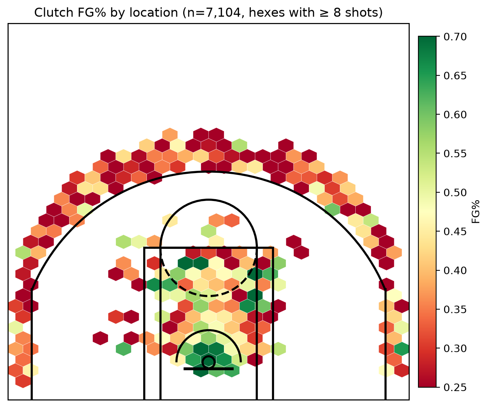
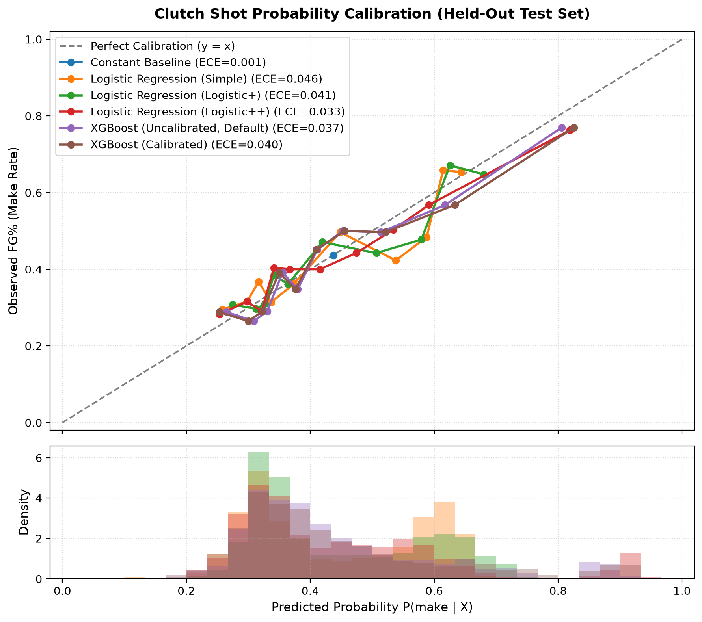
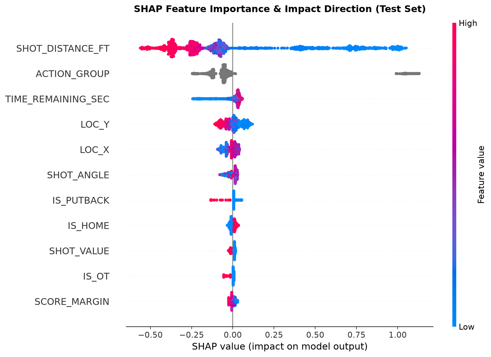

# NBA Clutch Decision Engine

A sports analytics and machine learning project that models **shot quality in NBA clutch time** and turns it into **Expected Points (xP)** to compare late-game offensive options.

> **Status:** 🚧 Work in progress. The data pipeline and the shot-quality model (Phases 1 to 3) are complete for the 2025-26 regular season. The interactive simulator (Phase 4) is planned. See the [Roadmap](#roadmap).



*Field-goal percentage by court location for clutch shots (last 5 minutes, score margin ≤ 5). Only locations with enough attempts are shown.*

---

## Key findings

- **Where and what kind of shot explains almost everything.** Shot location and shot type account for about 89% of the model's total mean |SHAP|, and they are the only feature groups with a clearly detectable predictive gain in the ablation.
- **The model is useful but modest.** On held-out games, Brier score is about 9% lower than a constant baseline and ROC AUC is 0.66. Without defender information, that is the expected range for a shot-quality model.
- **It is calibrated out of the box.** A post-hoc calibrator (Platt scaling) is close to the identity mapping and does not help.
- **No detectable advantage over a well-specified logistic regression.** Once the logistic model also sees shot type, the XGBoost edge is about 0.0015 Brier with a confidence interval that includes zero.
- **No detectable effect of clock time or score margin on make probability.** Game-state features add at most about 0.0005 Brier, which cannot be told apart from zero with about 7,100 clutch shots. See [What we did not find](#what-we-did-not-find).
- **The dataset cannot measure a "clutch effect".** It contains only clutch shots, so there is no non-clutch baseline to compare against. See [Known limitations](#known-limitations).

## Motivation

Modern analytics tends to penalize mid-range jumpers in favor of layups and threes. The last five minutes of a close game plausibly change the picture: pace slows down, defenses tighten, and stars take a large share of self-created shots. Season-long averages and box scores don't capture that context: score margin, time left, court location, shot type. This project asks:

> Given the game state, how does shot efficiency shift under pressure, and which shot type and location carry the highest expected value?

The results so far answer the second half (location and shot type) much better than the first (pressure). The sections below say exactly what the data supports.

## Approach

1. **Ingest** shot-level data from the NBA stats API (`nba_api`) and cache it locally as Parquet.
2. **Enrich** shots with play-by-play data to attach the exact score margin *before* each attempt (using the score after the shot would leak the outcome into the features).
3. **Model** `P(make | shot context)` with gradient-boosted trees (XGBoost), with an emphasis on **probability calibration**, not just accuracy, and compare against a fair logistic regression baseline.
4. **Convert** probabilities to expected points:

   ```
   xP = P(make | X) × shot value (2 or 3)
   ```

5. **Decide** *(planned)*: in an interactive Streamlit app, compare options for a given game state. In tight situations (e.g. down 3 late), raw xP isn't the right objective, so the simulator will also report the probability of tying or taking the lead.

Everything runs locally on a laptop CPU. No GPU and no cloud services.

### Clutch definition

A shot counts as clutch if it is taken in the **last 5 minutes of the 4th quarter or overtime**, with the **score margin within 5 points** (measured before the shot, from the shooting team's perspective).

## Roadmap

| Phase | Deliverable | Status |
| :--- | :--- | :--- |
| 1. Foundation | Fetch league-wide shot data, cache to Parquet, half-court plotting | ✅ Done |
| 2. Context enrichment | Merge play-by-play to add pre-shot score margin; filter to clutch shots; validate | ✅ Done (2025-26 regular season) |
| 3. ML engine | Feature engineering, baselines, XGBoost, calibration, ablation, SHAP, prediction API | ✅ Done (v1) |
| 4. Simulator | Streamlit app with game-state inputs and an xP heatmap on the court | ⬜ Planned |

## Setup

Requires Python 3.10+.

```bash
git clone https://github.com/jlage24/nba-clutch-engine.git
cd <repo-folder>

python -m venv venv
source venv/bin/activate          # Windows: venv\Scripts\activate
pip install -r requirements.txt
pip install -r requirements-dev.txt   # only needed to run the tests
```

## Usage

Run the pipeline in order. Every download step is cached, so reruns skip anything already fetched.

```bash
python src/fetch_clutch_shots.py     # 1. shots for every team -> data/
python src/fetch_pbp.py              # 2. play-by-play for each game with late-game shots
python src/build_clutch_dataset.py   # 3. join shots + play-by-play -> data/processed/clutch_shots.parquet
python src/check_leakage.py          # 4. sanity check on the pre-shot score logic
python src/diagnostics.py            # 5. coverage, FG% by zone, shots per player
python src/plot_shots.py             # 6. shot map -> docs/clutch_shot_map.png
python src/features.py               # 7. feature table and split summary
python src/train.py                  # 8. baselines, XGBoost, calibration, metrics, saved models
python src/explain.py                # 9. SHAP plots and summaries -> docs/
python src/predict.py                # 10. demo: xP for a few hand-made shots (add --calibrated for the optional Platt step)
pytest                               # run the unit tests
```

Notes:

- Step 1 takes a few minutes and step 2 takes roughly 30 to 40 minutes per season, because requests are spaced out to avoid rate limiting. Both are resumable.
- `fetch_pbp.py --limit 20` downloads only the first 20 games, which is handy for testing the rest of the pipeline quickly.
- Trained models are written to `models/` (gitignored), including the XGBoost model in portable JSON format.

## Data

| Source | Used for |
| :--- | :--- |
| `ShotChartDetail` (`nba_api`) | Shot location (`LOC_X`, `LOC_Y`), distance, zone, action type, clock, result |
| `PlayByPlayV3` (`nba_api`) | Score before each event, shooter's side (home/away) |

`PlayByPlayV2` no longer returns data from the NBA API, so the pipeline uses V3.

Data is **not** committed to the repo. It is reproducible by running the pipeline above.

### Current dataset

Only the 2025-26 regular season is loaded so far.

| | |
| :--- | :--- |
| Games with play-by-play | 1,230 of 1,230 |
| Late-game shots (last 5 min, 4th quarter or OT) | 22,962 |
| Clutch shots (also within 5 points) | 7,104 across 543 games |
| Players with at least one clutch shot | 413 |
| Clutch shots per player | median 11, max 101; 76 players have 30 or more |

## Data validation

A model is only as good as its inputs, so the pipeline includes explicit checks:

- **Join integrity.** Shots are joined to play-by-play on `GAME_ID` and `GAME_EVENT_ID`. 100% of shots matched, and 100% of matched shots had identical court coordinates in both sources, which confirms the join pairs the right events and not just plausible ones.
- **No outcome leakage.** The margin is computed from the score *before* each shot. `check_leakage.py` verifies this: for every made field goal, the score change on that row must equal the shot value. Across the full season, 12 of 103,227 made field goals (0.01%) do not match. Made and missed shots also have the same average pre-shot margin (difference 0.02 points, z = 0.3), as they should if the margin carries no information about the outcome.
- **Event ordering.** The check caught a real bug in an earlier version: play-by-play events are not always in chronological order by `actionNumber`, because some corrected events receive a later number. Ordering by `actionId` instead fixed it, cutting mismatches from 368 (0.36%) to 12 (0.01%).
- **Plausibility checks.** Margins stay within ±5 and are centered on a tied game, and field-goal percentages by shot type and zone land in realistic ranges (restricted area 65%, mid-range 38%, above-the-break threes 30%).
- **Placeholder coordinates.** Coordinates exactly at (0, 0) occur almost exclusively on tip and putback attempts (98.65% of such clutch shots; 98.11% across all 2025-26 shots), and the API's own `SHOT_DISTANCE` is 0 for them. Layups at (0, 0) convert at 53.5%, against 70.3% for layups at 0.5 to 1.5 ft. The model receives an `IS_PUTBACK` flag, and `predict.py` clamps user-specified distances below 1 ft unless the shot is a tip or putback.

## Features

The final model uses 11 features:

| Group | Features |
| :--- | :--- |
| Location | `LOC_X`, `LOC_Y`, `SHOT_DISTANCE_FT`, `SHOT_ANGLE` (polar coordinates derived from `LOC_X`, `LOC_Y`) |
| Shot type | `ACTION_GROUP` (8 shot families), `SHOT_VALUE` (2PT or 3PT), `IS_PUTBACK` |
| Game context | `TIME_REMAINING_SEC`, `SCORE_MARGIN` (pre-shot, shooter's perspective), `IS_OT`, `IS_HOME` |

`IS_PLAYOFFS` is supported by the feature code but excluded while only regular-season data is loaded (it is constant). Player identity is deliberately **not** a feature: with a median of 11 clutch shots per player, player effects would be mostly noise. Assist information is also excluded, since it exists only on made shots and would leak the outcome.

## Results

All models predict the pre-shot probability that a field goal is made. The 2025-26 regular season is split by game: **5,550 training shots across 434 games** (make rate 43.77%) and a **held-out set of 1,554 shots across 109 games** (make rate 43.69%). Shots from the same game never appear on both sides of any split. Confidence intervals come from 500 game-level cluster bootstrap resamples. Hyperparameters were chosen with a 108-configuration grid search under 5-fold grouped cross-validation, with early stopping on an inner grouped split. Expected Calibration Error (ECE) uses 10 equal-frequency bins and is reported as a point estimate only, because percentile bootstrap intervals for ECE are biased upward.

### Held-out benchmark

| Model | Brier (95% CI) | Log loss (95% CI) | ROC AUC (95% CI) | ECE |
| :--- | :---: | :---: | :---: | :---: |
| Constant baseline (training make rate) | 0.2460 (0.2435, 0.2486) | 0.6852 (0.6801, 0.6903) | 0.500 | 0.0007 |
| Logistic regression (simple) | 0.2336 (0.2263, 0.2403) | 0.6600 (0.6444, 0.6741) | 0.636 (0.609, 0.666) | 0.0462 |
| Logistic+ (nonlinear distance, interaction) | 0.2328 (0.2257, 0.2393) | 0.6587 (0.6431, 0.6731) | 0.638 (0.611, 0.666) | 0.0409 |
| Logistic++ (adds shot type, putback, home, OT) | 0.2258 (0.2181, 0.2329) | 0.6430 (0.6246, 0.6609) | 0.652 (0.627, 0.678) | 0.0376 |
| XGBoost (11 features, depth 3, 49 trees) | 0.2243 (0.2169, 0.2306) | 0.6391 (0.6231, 0.6523) | 0.664 (0.640, 0.692) | 0.0294 |
| XGBoost + Platt calibration | 0.2247 (0.2165, 0.2315) | 0.6399 (0.6217, 0.6548) | 0.664 (0.640, 0.692) | 0.0339 |

With about 155 shots per bin on this test set, sampling noise alone produces an expected ECE of roughly 0.03 even for a perfectly calibrated model, so the out-of-fold ECE on the training set (0.011 for raw XGBoost) and the reliability diagram are more informative than the test-set ECE.



**Paired differences on identical resampled games (held-out set):**

| Comparison | ΔBrier (95% CI) | ΔLog loss (95% CI) | ΔROC AUC (95% CI) |
| :--- | :---: | :---: | :---: |
| XGBoost vs constant | -0.0217 (-0.0283, -0.0159), p < 0.002 | -0.0461 (-0.0602, -0.0337), p < 0.002 | +0.164 (+0.140, +0.192), p < 0.002 |
| XGBoost vs Logistic++ | -0.0015 (-0.0050, +0.0010), p = 0.33 | -0.0039 (-0.0127, +0.0020), p = 0.29 | +0.012 (+0.001, +0.025), p = 0.02 |

(500 resamples cannot resolve p-values below 0.002.) The XGBoost edge over Logistic++ is small, around 0.001 to 0.002 Brier, and whether it counts as "significant" depends on an arbitrary 0.05 threshold: an earlier version of the pipeline gave p = 0.06 for the Brier difference, and the feature sets of the models changed between versions. The AUC result is one of three uncorrected comparisons and is weak evidence on its own, so effect sizes with intervals are reported rather than verdicts.

### Calibration

Calibrators were compared with nested grouped cross-validation on the training set, without touching the test set. Platt scaling (Brier 0.2203, log loss 0.6295) beat isotonic regression (Brier 0.2211, log loss 0.6588), but the fitted Platt parameters (slope 1.14, intercept 0.04) are close to the identity, so raw XGBoost probabilities are already well calibrated. **Uncalibrated XGBoost is the default**, and the Platt step is an optional flag in `predict.py`.

### Feature ablation

Cumulative feature groups under 5-fold grouped cross-validation (out-of-fold, training set), with the same folds and final hyperparameters:

| Feature subset | OOF Brier | OOF log loss | OOF AUC | ΔBrier vs previous step (95% CI) |
| :--- | :---: | :---: | :---: | :---: |
| (a) Location only | 0.22431 | 0.63991 | 0.6577 | n/a |
| (b) + shot type (`ACTION_GROUP`, `SHOT_VALUE`, `IS_PUTBACK`) | 0.22091 | 0.63137 | 0.6649 | -0.00340 (-0.00456, -0.00217) |
| (c) + `TIME_REMAINING_SEC` | 0.22082 | 0.63119 | 0.6669 | -0.00009 (-0.00055, +0.00038) |
| (d) + `SCORE_MARGIN` | 0.22071 | 0.63096 | 0.6683 | -0.00010 (-0.00037, +0.00016) |
| (e) + `IS_HOME` | 0.22043 | 0.63030 | 0.6690 | -0.00028 (-0.00053, -0.00006) |
| (f) + `IS_OT` (full, 11 features) | 0.22039 | 0.63025 | 0.6701 | -0.00004 (-0.00031, +0.00024) |

Adding shot type to location is the only step with a clear gain. The joint comparison of (b) against the full model is small and inconclusive: ΔBrier = -0.00052 (95% CI -0.00099 to +0.00001) out-of-fold, and -0.00048 (-0.00149 to +0.00056) on the held-out games. The ablation involves about 15 uncorrected comparisons, so isolated nominal p-values (for example 0.012 for home court) are weak evidence: they are compatible with a small real effect (home teams do shoot slightly better in this data, 45.4% vs 42.1%) and with noise, and this sample cannot tell the two apart.

### What the model learned (SHAP)

SHAP values were computed on the held-out games.

| Feature group | Mean \|SHAP\| | Share |
| :--- | :---: | :---: |
| Location | 0.4418 | 64.6% |
| Shot type | 0.1652 | 24.1% |
| Game context | 0.0771 | 11.3% |

`LOC_X`, `LOC_Y`, `SHOT_DISTANCE_FT` and `SHOT_ANGLE` are geometrically collinear, so splitting credit among them is arbitrary; only the group total is meaningful. Shares of |SHAP| measure attribution magnitude, not predictive necessity: `TIME_REMAINING_SEC` has a sizeable SHAP share but no detectable out-of-fold gain, which is consistent with attributions being shared across correlated features.



Dunks add on average +1.07 log-odds through `ACTION_GROUP`, tip and putback attempts get a small penalty through `IS_PUTBACK` (-0.11), and the distance curve falls steeply over the first four feet, flattens through the mid-range, and drops again beyond the three-point line. Further plots: `docs/shap_dependence_distance.png`, `docs/shap_dependence_margin.png`, `docs/shap_action_group_bar.png`.

### What we did not find

1. **No detectable effect of clock time or score margin on make probability.** Raw FG% is lower in the final 30 seconds (40.2% vs 45.7% from 60 to 180 seconds), and trailing teams take more threes (46.1% of attempts when down 3 to 5, vs 37.7% when up 3 to 5). But once location and shot type are known, neither feature improves out-of-fold scoring accuracy. The raw differences are consistent with shot-mix composition. With about 7,100 shots, effects of a few percentage points would not be detectable, so this is an absence of evidence, not evidence of absence.
2. **No detectable non-linear advantage over Logistic++.** When the logistic model sees the same domain features (shot type, putback flag, distance polynomials, angle), the gap to XGBoost is about 0.001 to 0.002 Brier with an interval that includes zero.
3. **No overtime conclusion.** Overtime clutch shots convert at 40.3% vs 44.3% in regulation (949 vs 6,155 shots), but the shot mix explains only a small part of that gap, and the sample cannot separate fatigue from noise.

## Known limitations

Being upfront about what this model can and can't claim:

- **Clutch-only dataset.** No non-clutch shots are included, so the model **cannot measure whether players shoot better or worse in the clutch than in normal play**. Claims about "clutch performance" or "choking" are not supported by this data.
- **Single season, repeated test inspection.** Diagnostics were run on the held-out games several times (for example, investigating the (0, 0) coordinate anomaly motivated `IS_PUTBACK`), so those games are no longer a pristine test. A fresh season is needed for a final untouched evaluation.
- **Selection bias.** The model learns from shots that were *taken*, not from alternatives that weren't. It estimates shot quality, not the causal effect of choosing a different shot.
- **No defender information.** The shot chart data has no contest distance or defender context, which is a major driver of shot quality. The model predicts the average conversion rate of a shot of that type from that location, not how hard the attempt was.
- **Small samples per player.** The median player has 11 clutch shots, so player-level effects are not estimated.
- **Assisted vs. unassisted shots** aren't equivalent options, and the assist flag only exists for made shots, so it cannot be used as a feature without leaking the outcome.
- **No free throws or turnovers** in the shot chart, so drawing fouls isn't captured in xP.

## Next steps (under consideration)

- **More seasons**, mainly to get a fresh untouched test season and tighter intervals.
- **Train on all shots, not only clutch.** The raw data already holds about 219,000 shots. A model trained on non-clutch shots and applied to clutch shots would estimate the "clutch effect" directly as a residual, with far more data for location and shot-type effects.
- **Decision layer for the simulator.** Win probability and the chance of tying or taking the lead, since game state barely changes the make probability but strongly changes which shot is worth taking.

## Project structure

```text
.
├── src/
│   ├── fetch_clutch_shots.py     # download shots per team (cached)
│   ├── fetch_pbp.py              # download play-by-play per game (cached)
│   ├── build_clutch_dataset.py   # join + pre-shot margin + clutch filter
│   ├── check_leakage.py          # sanity check on the score logic
│   ├── diagnostics.py            # coverage, FG% by zone, shots per player
│   ├── court.py                  # half-court drawing
│   ├── plot_shots.py             # shot map
│   ├── features.py               # feature engineering and grouped split
│   ├── evaluate.py               # metrics, game-level bootstrap, reliability plot
│   ├── train.py                  # baselines, XGBoost, calibration, saved models
│   ├── explain.py                # SHAP analysis
│   └── predict.py                # P(make) and xP for a single shot or a table
├── tests/                        # pytest unit tests
├── docs/                         # figures used in this README
├── models/                       # gitignored: trained model files
├── data/                         # gitignored: raw and processed Parquet files
├── requirements.txt
└── requirements-dev.txt
```

## Tech stack

Python · pandas · PyArrow/Parquet · nba_api · XGBoost · scikit-learn · SHAP · Matplotlib · pytest · Streamlit *(planned)*

## License

MIT. See [LICENSE](LICENSE).

## Acknowledgments

Data from [`nba_api`](https://github.com/swar/nba_api), a client for the public NBA stats endpoints. This project is not affiliated with or endorsed by the NBA.